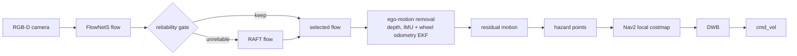

# RAPID-NAV

*Reliability-Aware Perception for Intelligent Dynamic Navigation*

[](https://github.com/code-master-harsh/rapid-nav/actions/workflows/ci.yml)

A differential-drive mobile robot in Gazebo that uses optical flow to see which things move. Fast flow (FlowNetS) is
used by default, and accurate flow (RAFT) is used when a reliability check fails. The robot's own motion is removed
with depth, the IMU and wheel odometry, and the remaining motion becomes hazards in the Nav2 local costmap.

A project for AR522 Robot Vision and AR511 Autonomous Mobile Robots at CAIR, IIT Mandi.

## Status

Every part of the project is planned; none is built yet.

| Part | Stage | Status |
|---|---|---|
| Robot and simulation | S1 | planned |
| Perception | S2 | planned |
| Ego-motion compensation | S3 | planned |
| Dynamic scenarios | S4 | planned |
| Navigation baseline | S5 | planned |
| Hazard costmap | S6 | planned |
| Adaptive flow | S7 | planned |
| Experiments | S8 | planned |

## Pipeline



See [docs/architecture.md](docs/architecture.md) for the design.

## Repository layout

- `src/`: ROS 2 packages (from the next milestone).
- `prototypes/`: reference code, not built.
- `docs/`: setup, development and architecture notes.
- `docker/`: optional build-and-test image for machines without a native ROS 2 install.
- `scripts/`: `dev.sh`, which drives the Docker image.

## Requirements

- Ubuntu 24.04
- ROS 2 Jazzy
- Gazebo Harmonic (`ros-jazzy-ros-gz`)

The full steps are in [docs/setup.md](docs/setup.md).

## Quick start

```bash
mkdir -p ~/ros_ws && cd ~/ros_ws
git clone https://github.com/code-master-harsh/rapid-nav.git
cd rapid-nav
sudo rosdep init   # only once per machine; skip if it says it is already initialised
rosdep update
rosdep install --from-paths src --ignore-src -y
colcon build --symlink-install
source install/setup.bash
```

Launch instructions arrive with the robot package.

## Team

Rishi Atreya, Kamalesh Kumar B, Jaspinder Kaur, Harsh Vardhan (CAIR, IIT Mandi).

## Licence

MIT, see [LICENSE](LICENSE).
